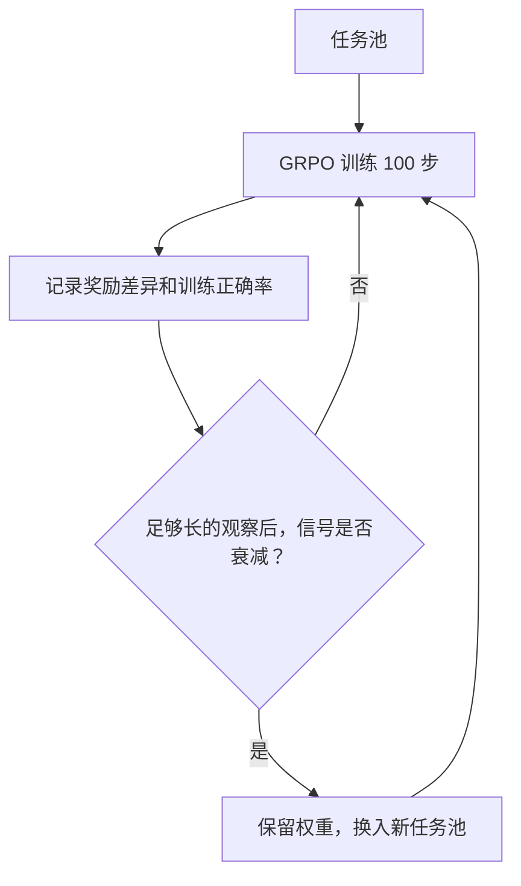

**核心判断：A-RSI 最重要的不是提出一个新的通用 Agent，而是把 RSI 训练中的两个问题拆开：何时换新任务、怎样确保自生成任务的答案可信。** 它对多模态强化学习有效，但“自适应时机比固定每三轮换题更强”仍没有被单独证明。

## 一、学会换题，比一味多刷题更重要

想象一个学生反复练习同一套试卷。起初错误很多，练习有效；后来可能全部答对，或最难题始终不会。无论哪一种，继续练旧题都不一定有帮助。训练 AI 也有类似问题。

A-RSI 面向**不使用外部训练样本或人工答案标签**的多模态自训练场景。与只研究“接下来应该出什么题”的方法相比，它把注意力放在另一个问题：**现有题库什么时候已经无法继续提供足够的学习信号？**

在论文采用的 GRPO 中，同一道题采样多个回答，依赖组内奖励差异来计算相对优势。假设同一道题采样 8 次：

| 8 次采样的结果 | 组内比较 | 典型含义 |
| --- | --- | --- |
| 5 对、3 错 | 奖励存在差异 | 有可用的相对优势信号 |
| 8 次全对 | 奖励相同 | 组内优势可能全为零 |
| 8 次全错 | 奖励相同 | 组内优势也可能全为零 |

这里的“全对/全错”只是直觉化示例。**真正决定 GRPO 组内信号的是奖励是否存在差异**，奖励还可能包含格式、是否完成等因素；全错也不一定完全没有其他形式的奖励差异。

因此，训练集大小并不等于有效训练信号的大小。

## 二、一个训练日志驱动的换题检测器

A-RSI 并不拿验证集或测试集分数来决定换题，而是监测训练日志中的两个量：

- $U_w$：第 $w$ 个窗口中，采样结果出现非零组内相对优势的不同题目数量，用来近似衡量剩余学习信号。
- $a_w$：训练侧的正确率，观察同一题库上的上升幅度。

每个训练窗口包含 **100 次 GRPO 更新**。同一题库至少训练三个窗口后，若满足任一条件，则触发整个题库替换：

$$
U_w \le 0.85U_{w-2}
\quad \text{或} \quad
a_w-a_{w-2}\ge 10\text{ 个百分点}
$$

例如，训练日志显示 $U$ 从 **239 降到 195**，保留率为 **81.59%**，低于 85%，因而触发刷新。触发后保留模型权重，换入新的任务池；论文主实验开始使用 **500 道旧任务**，新任务池每次 **400 道**。这些阈值是本文设置，不是跨场景验证过的最优阈值。



这个机制看起来很简单，但有工程价值：**优化器不再只问“哪个候选分数最高”，还开始问“当前这批实验还能不能继续产生信息”。**

不过，$U_w$ 是代理指标，不是“是否已经真正学会”的证明。任务难度、采样策略以及格式/终止奖励的变化，都可能改变这个数值。[原论文 §3–4、附录控制器记录](https://arxiv.org/abs/2610.38568v1)。

## 三、自己出题可以，但不能自己投票决定答案

自训练还有另一种常见风险：模型先生成题目，再采样多个答案，最后把多数票当成“正确答案”。如果模型有系统性的共同错误，这个循环就可能越训越错。

A-RSI 的办法是**程序化生成题目，并由程序独立计算标准答案**。例如用脚本画一张柱状图，同时计算题目“图中 A 比 B 多多少”的数值答案。AI 需要读图、计算，参考答案却来自生成时的结构化数据，而不是模型自己的多数票。

```text
随机参数 ─┬─> 渲染图像 ─> 模型看图回答
          └─> 程序计算 ─> 参考答案
                              │
模型回答 ────────────────────> 计算奖励
```

论文还包含奖励规则与刷新条件的形式化/自动化检查，以及对已经生成任务的独立答案审计。这比简单的“自问自答”更可检验。

但 **Zero-Data 不等于没有任何先验信息**：生成程序、题目类型和配额仍由研究者预设；论文附录也披露，部分题型配比和主题词受到评测集元数据启发。它的准确含义是**不使用外部训练样本与人工答案标签**，而非完全脱离人为设计。[原论文 §3、附录题目生成与答案审计](https://arxiv.org/abs/2610.38568v1)。

## 四、实验结果：换新题有用，自适应时机尚未被隔离证明

主实验在 Qwen3-VL-8B 上训练，并以 **11 个多模态完整测试集的等权平均（Macro11）**评价，回答长度上限为 **8,192 tokens**。从共同训练起点 $S_t$ 的 **57.77** 到第八个后续训练窗口的 **61.05**，显示分数提升约 **3.28 个百分点**（论文按未四舍五入值记为约 **+3.27**），过程中引入 **800 道新任务**。

| 策略 | Macro11 | 累计新引入任务 |
| --- | ---: | ---: |
| **A-RSI：日志触发、随机替换** | **61.05**（第 8 窗口） | 800 |
| 每窗口刷新、难度自适应 | 60.64（第 8 窗口） | 3,200 |
| 每两窗口刷新、Frontier 选题 | 59.89（第 8 窗口） | 1,200 |
| 同样触发器、Frontier 选题 | 59.59（第 8 窗口） | 800 |
| **不刷新旧题** | **58.35（仅第 6 窗口）** | 0 |

*来源：原论文 Table 4、Table 9、附录的等步数对照。请注意“不刷新”没有第 8 窗口结果，因此不能把所有数值当作完全匹配的终点比较。*

在第 6 窗口的匹配训练进度下，A-RSI 得分 **60.40**，继续用旧题为 **58.35**，差 **+2.05** 分。这个结果支持**整套换题策略优于当前不换题方案**。但替换同时将活跃任务池从 500 缩至 400，因而不能将改善全部归因于“任务新鲜度”一个因素。

另外，论文测试的 **8 种难度或失败导向选题策略均未超过相应随机选择对照**，这是一项有价值的负面实验结果。[原论文 Table 5 及附录选题消融](https://arxiv.org/abs/2610.38568v1)。

### 最关键的局限：还不能说“智能决定时机”优于固定每三轮刷新

实验里两次执行的刷新都恰好在**第三个训练窗口**后触发，与固定“每三窗口换题”完全一致。论文没有提供**固定每三窗口 + 同样随机选题 + 同样预算**的直接对照。

因此应该区分：

- **已得到支持**：新任务替换可以让训练继续受益；程序生成答案可以提供可独立检查的监督。
- **尚未证明**：训练日志控制器能够找到比简单固定周期更好的刷新时间。

这不是小细节，而是论文标题里“Adaptive”能否独立产生价值的关键实验。[原论文 §6.1、附录对照与结论边界](https://arxiv.org/abs/2610.38568v1)。

### 分数上升，也不等于推理本身都进步了

论文对输出进行了更细的拆分：在 Qwen 从 $S_t$ 到最终状态的 Macro11 对比中，**两端都能正常完成回答**的样本对总分变化的贡献约为 **−0.71 个百分点**；其他样本状态贡献约 **+3.98 个百分点**。也就是说，整体改善的重要部分与**减少截断、让回答完成**有关，而不能统统记作已完成回答的推理准确性提高。

作者也报告其他模型的模式不完全相同，因此不应把“只学会停止”当作所有模型的统一结论。[原论文 Table 16、长度与完成情况分析](https://arxiv.org/abs/2610.38568v1)。

## 五、对通用 RSI System 的意义：把“停滞检测”做成一个可复用组件

对以 Kaggle 为首个验证场景的通用 RSI 系统，**无需直接搬运 A-RSI 的 GRPO、视觉任务生成器或模型权重训练**。更值得借鉴的是：Optimization Loop 必须判断自己是否仍在获得新的有效信息。

一个可迁移的架构是：

```text
Solver / Experiment Runner
          │ 轨迹、分数、预算、错误
          ▼
Evaluator ──> Experiment Signal Monitor
                  │ 进展 / 停滞 / 低价值重复
                  ▼
Optimizer ──> 继续局部搜索 / 切换搜索空间
          │
          └────────> 下一轮实验
```

Kaggle 场景的具体实现可以监测：最近若干次实验的**独立验证集增益、重复方案比例、无效实验率、单位 GPU/Token 成本产生的信息量**，再决定继续微调当前特征与参数，还是切换模型族、特征工程或验证方案。

**注意这只是设计迁移，不是指标等价**。Kaggle 的一次 RMSE/ROC-AUC 分数不等于 GRPO 的组内相对优势，不能照搬 85% 或 10 个百分点的阈值，也不能仅凭“没涨分”断定没有获取有用信息。

工程上建议先做三个小实验：

1. **固定预算对照**：始终使用旧搜索空间 vs 固定周期切换 vs 用历史增益/新颖性切换，比较相同预算下的独立验证集与公开榜单表现。
2. **明确可验证反馈**：把交叉验证、泄漏检查、数据切分与训练随机种子作为可靠评测的一部分，不让 Optimizer 自己给自己打分。
3. **分开记录贡献**：将 Solver 改进、Harness/Skill 改进、Experiment Pool 切换分别做消融，避免把新增算力或更长输出的收益误判成优化策略更强。

与 Harness² 一类修改 Agent Harness 的研究相比，A-RSI 的优化对象主要是**训练任务池刷新和模型参数学习**；它不是一个能直接接 Kaggle 任务的完整通用 RSI 黑盒框架。

## 结论

A-RSI 值得记住的不是单一分数，而是三条可以迁移的判断：

**其一，旧任务仍在消耗算力，不代表它们仍在教会模型新东西。其二，自生成监督必须有模型之外的可验证依据。其三，动态策略看似有效，必须与对应的简单固定策略进行公平对照。**

对通用 RSI Optimization System，建议把它作为**Experiment Saturation Detection / Task Refresh**方面的参考论文，而不是直接作为 Kaggle Solver 接入候选。

## 来源与阅读边界

- [原论文：A-RSI: Adaptive Task Refresh for Zero-Data Multimodal Self-Improvement（arXiv:2610.38568v1）](https://arxiv.org/abs/2610.38568v1)
- [作者项目页、训练曲线及结果交互演示](https://seerray-lab.github.io/A-RSI/)
- [arXiv PDF](https://arxiv.org/pdf/2610.38568v1)

*原论文首次提交：2026-10-28；本站解读：2026-11-03。本文基于论文摘要、作者项目页公开的实验表格和方法说明，以及可检索的正文摘录交叉核对；本次未能直接打开 arXiv 全文 HTML/PDF，因此未独立复核全部附录和证明。项目页截至查阅时仍标注代码即将开放。所有实验成绩均为论文报告，非本站独立复现结果。*
