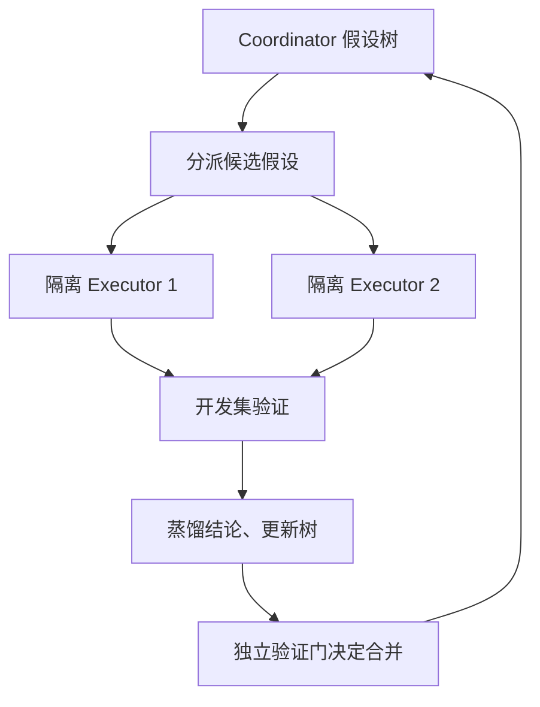

> **核心判断：**Arbor 解决的是“如何组织一个长期研究项目”，而不是对某个程序做无数次局部变异。它用一个持续工作的负责人管理假设树，让短生命周期的研究员分别完成实验。

## 为什么需要它

科研的难点不只是写代码：项目常常有多个互斥假设，部分失败仍提供有用信息，还需要在不同方向之间转移预算。一个单线程 Agent 容易只记得最新实验，遗忘旧路线或在无证据时合并看起来不错的补丁。Arbor 把研究过程从聊天记录升级成可以追踪因果脉络的假设树。

## 它如何运行：让改进可回溯

长生命周期 **Coordinator** 负责观察当前树、提出新假设、选择叶子节点和合并决策；短生命周期 **Executor** 在隔离 git worktree 里实现一个候选并提交真实验证证据。假设树节点绑定**研究假设、可执行代码版本、评测证据和可复用结论**。每一轮经过 Observe → Ideate → Select → Dispatch → Backpropagate → Decide；真正合并时用 held-out 检查，不能只靠开发集增益。

## 实验报告到底证明什么

作者在**六项真实研究任务**中报告 Arbor 在 held-out 指标上均优于其 Codex 与 Claude Code 对照，平均相对提升超过 **2.5 倍**；在 **MLE-Bench Lite、GPT-5.5** 设置下报告 **86.36% Any-Medal**，同时有效提交率为 **100%**。同一控制器换 **Gemini-3-Flash** 时 Any-Medal 为 **81.82%**。需注意 MLE-Lite 是较小子集，不能拿 86.36% 直接与其他框架完整 75 题的成绩排名。[论文 §5、Table 3](https://arxiv.org/abs/2606.11926)。

## 关键局限与反证

假设树能组织证据，不保证每个研究假设正确；多 Executor 会放大 GPU 和环境成本。held-out 评估若反复参与方案挑选，也会变成新的开发集。论文中的 2.5 倍是多任务**相对 held-out 增益的聚合**，不是通过率翻倍，也不是每道题都胜出 2.5 倍。注意它与另一篇同名 Arbor（专注推理性能优化）不同。

## 对 Kaggle RSI System 的启发

如果你已经具备 Kaggle 输入/执行/成绩接口，Arbor 适合作为独立 RSI System 以薄 Adapter 接入。但最值得抄的是假设树记录格式：每个节点同时存**假设、代码版本、实验环境、验证结论与预算**。把基线复现节点固定为树根，后续可恢复失败分叉，禁止未验证的开发集高分直接升为 champion。

## 资料与复现入口

- [原论文](https://arxiv.org/abs/2606.11926)
- [官方代码仓库](https://github.com/RUC-NLPIR/Arbor)

*本文解读日期：2026-11-04。实验数据来源于作者，本文没有进行独立复现。*
