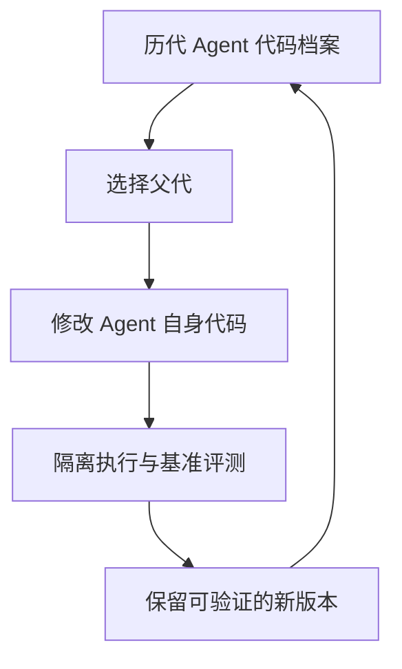

> **核心判断：**Darwin Gödel Machine（DGM）的突破是允许 Coding Agent 修改**自己用于完成编程任务的代码**，再靠外部评测决定哪些版本应该留在演化树里。

## 为什么需要它

传统程序优化器只能改用户提交的程序；自身的工具调用、编辑器接口、上下文压缩与循环规则通常不在修改范围内。可是假如 Agent 总是因为编辑补丁失败而错失任务，优化用户代码并不能解决问题。DGM 把“修复修理工具本身”放入搜索空间。

## 核心机制：究竟进化了哪一层

保留一个由不同 Agent 版本构成的**开放式档案**；选择一个已有版本作为父代；使用基础模型提出自修改补丁，例如改善文件编辑、工具反馈或长上下文处理；在隔离环境中运行 Coding Benchmark；把验证过的新版本加到档案而不是只保留单一冠军。档案中的中间版本可能不是最好，但可以成为后续重大进步的踏脚石。

它借用 Gödel Machine 的自修改愿景，但**用经验评测替代要求每次修改给出数学最优性证明**。

## 实验依据与可比性

论文摘要报告原始 Coding Agent 经演化后，在特定 **SWE-bench** 设定上从 **20.0% 到 50.0%**，在 **Polyglot** 的报告设置上从 **14.2% 到 30.7%**；作者还对不具备开放档案或自修改能力的基线作比较。[论文 §4 与摘要](https://arxiv.org/abs/2505.22954)。这些不是截至现在所有软件工程基准的最优成绩，也不应与不同年份、不同任务划分的 SWE-bench Verified 结果混用。

## 局限及不应过度推断之处

“会修改自己的代码”不等于“证明修改一定更安全或更聪明”；评测覆盖有限，搜索长期会过拟合验证集；自修改代码可能破坏工具安全、越权访问或造成重复错误。作者使用沙箱与人工监管作为实验防护，所以不能忽略这些防护，把它直接放到生产环境里自修改部署。

## 对 Kaggle RSI 与通用优化系统的启发

DGM 提醒我们，RSI System 应当明确**优化边界**：任务解代码可以由 Solver 改，Harness 核心只在隔离开发分支中由 Optimizer 改，鉴权、数据隔离、成本额度、生产部署和最终评测器始终在可信控制平面之外。每次候选 Harness 变更必须保留 diff、历史父代、运行结果和回滚点。适合研究 Harness 演化思想，但不是现成 Kaggle 完整求解器。

## 原始资料

- [原论文](https://arxiv.org/abs/2505.22954)
- [官方代码](https://github.com/jennyzzt/dgm)

*解读于 2026-11-04。数字为论文或项目作者报告，非独立复现。*
