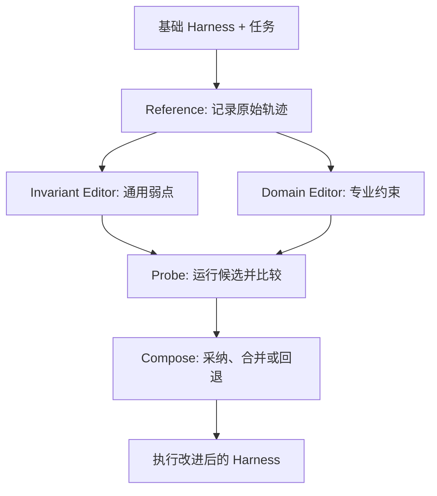
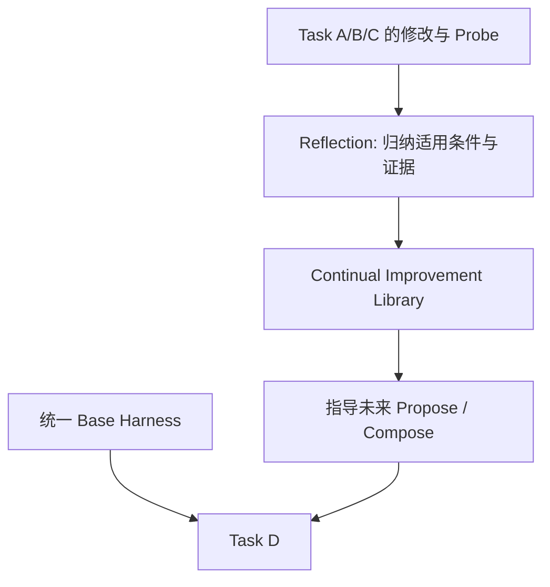
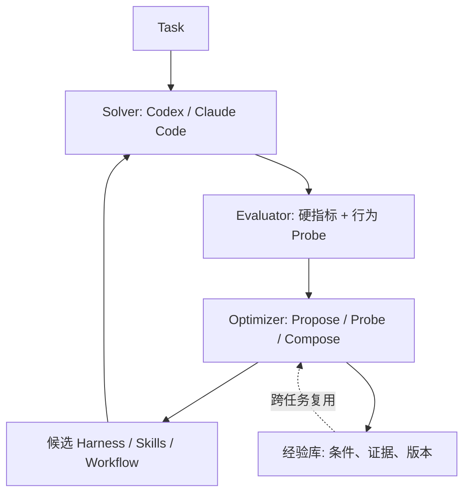

**一句话理解：Harness² 不训练更强的模型，而是让 Agent 改进自己的工作方式，并把“怎样改进”沉淀为下一次可复用的经验。**

> 原论文：[Harness²: Recursive Agent Harnessing for an Open World](https://arxiv.org/abs/2610.14224v1)（2026-10-09，v1）；[官方代码](https://github.com/google-research/harness2)。解读日期：2026-10-28。
> 同日修订：补充开放任务的行为反馈、结果验证边界，以及两类 Harness 的区别。

## 一、真正限制 Agent 的，有时不是模型，而是工作方法

想象两个使用同一个大模型的程序员。第一个修完代码就宣布完成；第二个会检查结构、修改代码、执行测试，再打开交付物确认结果。差别不在“大脑”，而在工作流程。

这套模型外围的执行支架叫 **Harness**：Prompt、工具说明、Guardrails、记忆、Skills、脚本、子 Agent 和插件。论文的核心假设是 **Agent = Model + Harness**：保持模型权重不变，也可以通过优化 Harness 改进任务表现（[论文 §2.1](https://arxiv.org/abs/2610.14224v1)）。

但两个矛盾一直存在。第一，现实任务常常没有即时正确答案：Kaggle 有分数，代码有单测，复杂办公任务却不一定有可靠 Verifier。第二，某个任务改出来的最优流程，可能对下一个任务构成干扰。

因此论文追问：**缺乏 Ground Truth 时如何修改 Harness？如何让本次修改改善未来的修改能力？**

## 二、第一层递归：Propose–Probe–Compose 用实际行为指导修改

论文提出任务级递归，以相同模型和环境下的执行对比作为证据（[论文 §2.2、Figure 3](https://arxiv.org/abs/2610.14224v1)）。

**Reference**：先执行一次，记录工具调用、行动轨迹和交付物。轨迹告诉我们 Agent *做了什么*，不自动说明 *做得对不对*。

**Propose**：Invariant Editor 关注通用流程，例如规划、工具使用、上下文管理和验证；Domain Editor 关注当前领域的规则、格式和技能。每个候选是可以执行的文件修改，不只是模糊的提示词建议。

**Probe**：在同任务、同模型、匹配环境下运行不同 Harness，比较是否减少遗漏、是否改变工具选择、是否引入新错误。它为修改提供行为证据，但模型的共同偏差和执行随机性仍可能误导判断。

**Compose**：根据轨迹、候选差异和交付物，选择一个修改、组合多个修改、调整冲突，或保留原 Harness。最终版本还要重新执行。

例如一个 Agent 做预算报告，原版没有核对多个源文件，也没重新打开生成的表格。优化后加入跨文件数字核对和最终文件检查。这类收益来自补全工作流程，而非改动大模型权重。

### 没有标准答案，Optimizer 凭什么判断修改有用？

写调研报告、处理复杂办公流程时，往往没有可靠标准答案，也未必能立刻给结果打分。Harness² 的做法是：**先看修改前后的实际执行，是否出现了预期的行为变化。** 这给 Optimizer 一个可观察的信号，帮助它决定保留、调整还是撤销修改（[论文 §2.2.1](https://arxiv.org/html/2610.14224v1#S2.SS2.SSS1)）。

下面是便于理解的示例，不是论文的实验记录：

| 修改目标 | 修改前的执行轨迹 | 修改后可以检查的证据 |
|---|---|---|
| 补上测试 | 改完代码就结束 | 实际运行相关测试，读取失败日志，修复后重跑 |
| 核查报告证据 | 直接沿用摘要中的结论 | 打开原始来源，核对引用与数据，修正冲突或标明不确定性 |
| 处理工具错误 | 调用失败后继续声称完成 | 识别错误，采取有边界的恢复措施，再检查产物 |

这里比较的是工具调用、返回信息和交付物，不能只看 Agent 是否在文字里说“我检查过了”。同任务、同模型和匹配环境能减少干扰，但单次对比仍可能受到执行随机性的影响。

**这些行为是结果质量的代理指标，不是正确答案。** 跑了测试可能漏掉关键 Bug；查了来源可能仍误读证据；增加检查也可能只让流程更长。若 Optimizer 把“测试次数更多”“引用更多”当成目标，就可能优化出更像认真工作的轨迹，实际结果反而变差。同源模型还可能共同认可一个错误前提（[论文 Appendix E.6、F](https://arxiv.org/html/2610.14224v1#A6)）。

所以应区分三层证据：**行为改善**说明执行方式按预期改变；**任务改善**需要检查最终产物；**优化能力改善**还需要在后续任务中验证经验是否持续有效。第一层不能直接证明后两层。论文的 Benchmark 分数属于研究者另行开展的结果评估，没有作为在线修改时的奖励输入。

工程上，可将行为对比用于提出和筛选修改，再用独立的结果评估验收：代码检查相关测试与兼容性，报告核查事实、引用和需求覆盖；已有可靠评分时继续使用评分。准备把经验推广到其他任务前，还应在保留的任务集上做回归验证，并重复关键执行以检查稳定性。没有充分结果证据时，结论应停留在“观察到行为变化”，保留失败记录与回退版本。**这是进一步的工程建议，不是论文已经实现的完整保障机制。**

### 并行与串行不是简单 Best-of-N

参数 $k$ 控制任务级探索预算。**Parallel** 同时探索更多候选，增加宽度；**Sequential** 以上一轮修改为起点继续改进，增加深度。它搜索的是 Harness 及其执行结果，不只是从多个最终答案中挑一个。$k>1$ 时，选择器选中某个交付物并不等于证明该方案最优（[论文 §2.2.2、Figure 4](https://arxiv.org/abs/2610.14224v1)）。

## 三、第二层递归：从局部成功中学习“怎样改进”

如果每次任务结束，优化全部丢失，就只是一次性的 Test-time Optimization。Harness² 的第二层让改善过程本身积累经验（[论文 §2.3](https://arxiv.org/abs/2610.14224v1)）。

这里需要区分两类 Harness：

| | Execution Harness | Improvement Harness |
|---|---|---|
| 作用 | 当前任务实际使用的执行配置，规定 Agent 怎么做事 | 跨任务保留经验，为后续 Harness 修改提供指导 |
| 内容 | Prompt、工具规则、Skills、脚本等 | 已采纳的 Harness、适用情境与执行对照证据 |
| 更新时机 | 在当前任务的提案、试跑与组合中调整 | 当前任务结束后更新经验库；任务内保持固定 |

因此，**Improvement Harness 不是一个直接执行所有通用任务的 Harness**。Optimizer 负责提出、试跑和选择修改，Improvement Harness 为这些操作提供可复用的经验与组件（[论文 §2.1、§2.3](https://arxiv.org/html/2610.14224v1#S2.SS3)）。

每条经验包含**可执行的已采纳 Harness** 和 **EXPERIENCE.md**，记录适用情境、改动理由、观察证据。证据不足就不必入库。比如“增加数据划分检查”是修改经验，“存在数据泄漏风险的建模任务”是适用条件，“修改前未检查、修改后发现并修正划分问题”是行为证据；它仍不能单独证明模型分数提高。这是说明字段含义的示例。

最重要的细节：**下一任务仍从共享 Base Harness 开始**，不是直接继承上一个任务所有局部修改。新任务的 Optimizer 可以从经验库挑选并调整相关组件。这能减少把表格任务的技巧硬套到图像任务、把特定项目规则塞进万能 Prompt 的风险。

这一层并没有让模型、阶段提示词或改进算法自由重写；变化的主要是持久化的 Improvement Harness 经验库。它属于 Harness 层 RSI，而不是权重层自训练。

## 四、它真正跑在什么之上？不用重新造一个 Codex

论文沿用 **OpenCode 与 Codex** 作为执行环境，使用固定权重的 **GLM-5 与 Gemini 3.5 Flash** 作为 Executor，构成四种组合。默认的 Harness 编辑与选择工作由 **Claude Opus 4.8 / OpenCode** 承担；另有同一模型兼任编辑与执行角色的实验（[论文 §3.1、Appendix D](https://arxiv.org/abs/2610.14224v1)）。

允许编辑八类组件：

| 组件 | 主要职责 |
|---|---|
| System Prompt / Guardrails | 始终生效的执行规则与限制 |
| Memory / Tool Guidance | 持久知识及工具使用方式 |
| Skills / Scripts | 按需专业流程与确定性脚本 |
| Subagents / Plugins | 分工执行与工具循环中间件 |

这意味着成熟 Agent 继续当 **Solver**，外部系统负责对 Harness 提案、验证和积累经验。它不是一个重新开发完整 Agent Runtime 的方案。

## 五、结果如何？要同时看指标、基线和成本

三个 Benchmark 分别覆盖 WorkBuddy（Code/Web/Office）、JobBench（端到端职业任务）和法律任务 LAB。作者报告三次不同任务顺序实验的平均结果（[论文 Table 1、Table 2](https://arxiv.org/abs/2610.14224v1)）。

| 任务与配置 | Base | Harness²，k=1 | 改善 |
|---|---:|---:|---:|
| WorkBuddy 平均，GLM-5 / OpenCode | 64.2 | 75.7 | +11.5 分 |
| JobBench，Gemini / OpenCode | 31.5 | 36.0 | +4.5 分 |
| LAB Partial，GLM-5 / OpenCode | 59.6% | 71.4% | +11.8 个百分点 |

**这三种分数不能直接比较。** WorkBuddy 结合多种检查，JobBench 按加权准则评估产物，LAB Partial 是法律评估标准通过率；其中一些依赖模型 Judge。真实评分用于研究者评估，**没有作为在线 Harness 修改的奖励输入**（[论文 Appendix B](https://arxiv.org/abs/2610.14224v1)）。

消融实验更能说明机制价值（Gemini / OpenCode、$k=1$，[论文 Table 3](https://arxiv.org/abs/2610.14224v1)）：

| 机制 | WorkBuddy | JobBench |
|---|---:|---:|
| 完整 Harness² | **77.5** | **36.0** |
| 去掉经验库 | 74.4 | 34.2 |
| 不区分两种 Editor | 74.6 | 32.3 |
| 去掉 Compose | 75.9 | 34.1 |

因此它并非仅靠多调用几次模型提升性能。经验库、编辑分工和组合策略都在此设置下贡献了收益。

一个更具象的案例来自 Figure 9：某 JobBench 任务原版得分 **43.1**，因为跨文件数字没有核对，生成文件也没有重新检查；加入通用验证规则、领域核对技能等修改后得分达到 **77.8**（[论文 Figure 9](https://arxiv.org/abs/2610.14224v1)）。

论文也报告了跨任务经验复用：JobBench 经验库迁移到 WorkBuddy 的 Code、Web、Office，分别改善约 **0.6、0.5、2.9 分**。这说明有迁移潜力，但不是无限持续进化的证明，部分分析还采用回顾性设置（[论文 Figure 7](https://arxiv.org/abs/2610.14224v1)）。

## 六、哪些事情论文还没解决？

**行为好转不等于答案正确。** 运行了测试、增加了检查，仍可能检查错方向；缺乏 Ground Truth 时，Probe 不能取代真正的正确性验证。

**优化不是免费的。** 提案、Probe、组合和复跑都需要 Token、执行时间与算力。Figure 6 展示了特定设置下有利的性能—计算权衡，但不保证所有生产任务性价比更高。

**持续积累可能引入坏经验。** 任务分布变化、模型评审误判及过拟合仍是风险。对未来任务的真实长期稳定性，论文证据有限。

**安全隔离需要另外做。** 官方仓库提醒 Executor 默认网络访问不受限，Codex 沙箱处于关闭状态，复现公开 Benchmark 时应隔离评分材料，避免答案泄漏（[官方 README](https://github.com/google-research/harness2)）。

## 七、给 RSI Optimization System 的工程启发

对于基于 Codex / Claude Code 的 RSI，我更建议**保留 Solver、Evaluator、Optimizer 三个核心角色**，借鉴这篇论文的优化机制：

**第一，双轨评价。** Kaggle 有提交有效性、分数、测试结果等客观信号，就应坚持使用 Hard Evaluator；Contrastive Probe 用来解释行为差异。已有标准答案时没有必要主动放弃它。

**第二，先优化能跑通。** Agent 如果常因训练超时、输出丢失、提交失败而中断，先修执行鲁棒性、检查点、探活和错误恢复，再优化排行榜分数。

**第三，经验不要一次成功就全局启用。** 建议按“单任务有效 → 相似任务验证 → 跨任务回归 → 通用经验”晋升，同时保存适用边界与回退策略。这是进一步的工程建议，**不是论文已经验证过的产品机制**。

**最终判断：Harness² 最大的贡献，是把一次任务的行为改进和下一次任务的改进能力连接起来。** 但真正的产品级 RSI，还需要可靠评估、负优化防护、版本回退和成本控制。方向不是再造一个通用 Agent，而是围绕成熟 Solver 建一个能证明增益、识别失败并安全回退的优化系统。

---

## 参考与证据范围

- [论文 v1：arXiv:2610.14224](https://arxiv.org/abs/2610.14224v1)：§2 方法、§3 实验、§4 分析、Appendix B/D。
- [官方代码：google-research/harness2](https://github.com/google-research/harness2)。
- 本文所有实验数字均为**论文报告**，未在本次解读中独立复现；RSI 架构建议属于工程推断。
