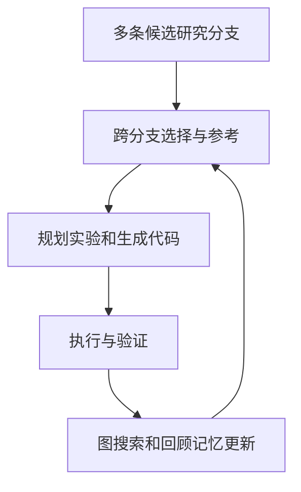

> **核心判断：**MLEvolve 把单纯沿一条路径不断改代码的流程升级成“可以互相引用的研究图”，重点解决多分支信息隔离和反复试错。

## 为什么需要它

假设三条实验分支分别探索 LightGBM、CatBoost 和特征工程。传统树搜索中，A 分支踩过的数据泄漏问题不会自然传给 B，B 发现的可用特征也未必影响 C。长时间搜索的价值应该是**每个失败都降低后续试错成本**，而不只是扩大候选总数。

## 它如何运行：让改进可回溯

第一，**Progressive MCGS** 在树分支之外加入参考边，让新候选借鉴非祖先分支的验证信息，并按搜索进展逐步由探索转向利用。第二，**Retrospective Memory** 从预置领域知识和实验过程累积记忆，供下一轮检索。第三，**Hierarchical Planning** 将选择方向和修改程序分开，根据状态选择全量重写、增量步骤或 diff 修改。执行评分后更新图结构与记忆，构成闭环。

## 实验报告到底证明什么

论文在 **完整 MLE-Bench、12 小时/任务、Gemini-3.1-Pro-Preview** 条件下报告 **65.3±0.8% Any-Medal**、**34.7% Gold**、**100% 有效提交**和 **76.0% 高于中位数**。按任务难度拆分，低、中、高分别为 **80.3%、64.0%、46.7% Medal**。这些数字对应特定模型与时间上限；与他人 24 小时方案比较时，不能只看最后一列。[论文 Table 1](https://arxiv.org/abs/2606.06473)。

## 关键局限与反证

图搜索增加了轨迹管理复杂度，还可能把一次偶然的高验证分当作跨分支知识；记忆检索若不分任务类型，会把特定比赛的解法错用到新比赛。任务搜索能力不等于“Optimizer 自己改变优化算法”。高有效提交率则更多说明工程可靠性，而非公榜分数必然泛化到私榜。

## 对 Kaggle RSI System 的启发

对于已接入的 MLEvolve，保留原生 Progressive MCGS 和 Memory，不必再做第二套外部候选树。Adapter 负责 Kaggle 任务下载/缓存、模型预算、执行状态、官方成绩与最终工件；先做 `reproduce_only` 无 RSI 的基线复现，再比较启用 MCGS 后的相同 GPU/Token 成本。重点审计跨分支引用的**验证划分、数据指纹与复现代码**。

## 资料与复现入口

- [原论文](https://arxiv.org/abs/2606.06473)
- [官方代码仓库](https://github.com/InternScience/MLEvolve)

*本文解读日期：2026-11-04。实验数据来源于作者，本文没有进行独立复现。*
