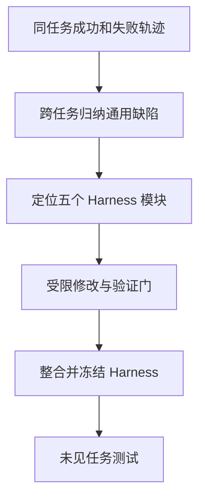

> **核心判断：**ModularRSI 的核心贡献不是“大规模改 Harness”，恰好相反：把 Harness 切成清晰的功能模块，仅在有跨任务证据时修改某一块，并用独立于评测集的任务检验泛化。

## 为什么需要它

Agent 做错一道题不代表 Harness 有问题，也可能只是随机推理失败。如果根据单条失败轨迹大改整个框架，常常把具体题目的修复脚本塞进通用逻辑。修改范围过大，后续即使涨分，也说不清到底是哪一处发挥作用。研发团队需要的是**可归因的修复**，不是一次不可控的大重构。

## 核心机制：究竟进化了哪一层

对同一任务采样多次，**对照成功与失败执行轨迹**，分离随机偏差与可操作的系统缺陷；再跨任务汇总重复问题。将 Harness 拆成 **Agent Loop、Tool Use、Observation Management、Context Management、Task Completion Detection** 五个模块，限制每次修改范围，各自进化后进行冲突集成。候选还需经过代码检查、diff 审查和小规模执行验证。进化任务来自与最终 Benchmark 隔离的外部数据，论文构建了 **2000 道任务**，实际主实验每域使用其中 **120 道**。

## 实验依据与可比性

官方[论文表 2 与仓库 README](https://github.com/IQuestLab/ModularRSI) 给出同一 DeepSeek-V4-Flash-Preview 基础模型、冻结后评测：Terminal-Bench 2.0 基线 **47.57%**，在 TB 相关进化集进化后 **52.43%**；SWE-Bench Verified 基线 **73.40%**，在 SWE 相关进化集进化后 **76.45%**。用 TB 任务进化的 Harness 在 SWE 上也达到 **75.80%**，说明有一定跨域迁移。注意这不是在最终测试集上继续实时搜索的分数。

## 局限及不应过度推断之处

Benchmark-disjoint 不能保证完全无概念重叠；成功与失败轨迹的对比是诊断线索，不是严格的因果识别。五模块边界可能不适合所有 Agent，实现里还涉及 Harbor 运行环境和较大进化任务集。仓库说明**研究代码为非商业 CC BY-NC 条款**，与部分上游依赖许可不同，商用前需核查。论文不能证明跨任意模型与领域永远增益。

## 对 Kaggle RSI 与通用优化系统的启发

这可能是最值得用来设计 **通用 Harness 优化器** 的论文之一。建议对自己的 Codex/Claude Code Harness 拆分 `agent_loop / tool_use / observation / context / completion`，把基础设施（下载、鉴权、预算、沙箱）放到不可修改层。使用多任务成功/失败轨迹对比，再通过静态检查、独立回归集、部署前验证三道关，确保得到可解释的增益。

## 原始资料

- [原论文](https://arxiv.org/abs/2609.14857v2)
- [官方代码](https://github.com/IQuestLab/ModularRSI)

*解读于 2026-11-04。数字为论文或项目作者报告，非独立复现。*
