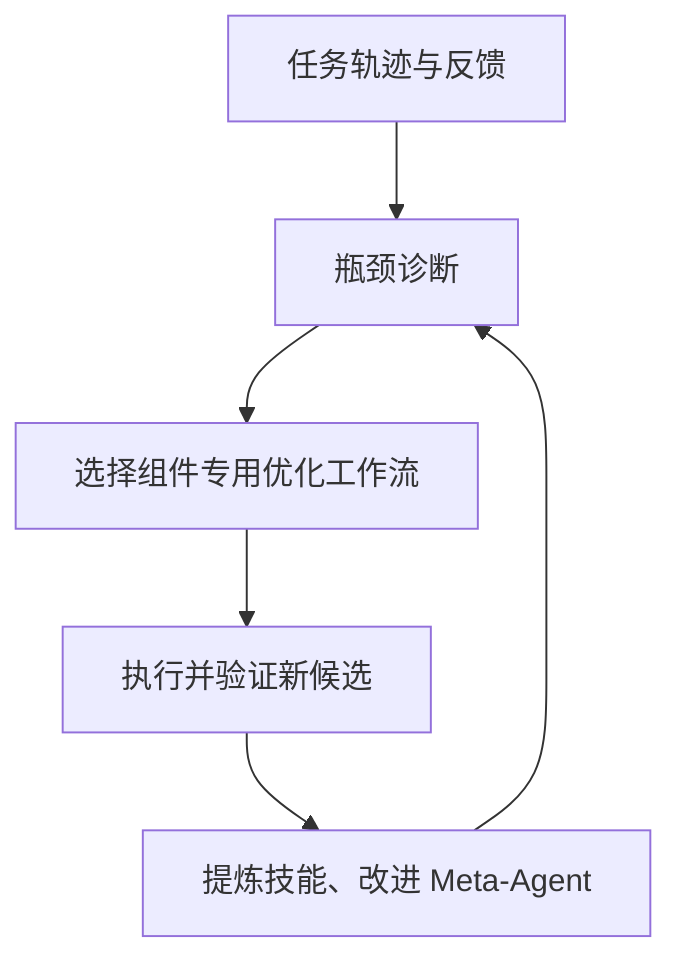

> **核心判断：**RSIFlow 认为“每个任务都使用同一条 RSI 流程”本身就是需要改进的设计。系统先诊断瓶颈，再选择合适的优化工作流，最后从工作流结果里学习如何更好地分配下一次改进。

## 为什么需要它

想象一个工程团队：代码错误、工具接口错误、资料检索不足，都让任务失败，但解决方案截然不同。固定 Optimizer 如果一律改 Prompt，可能对工具协议故障无能为力；一律改代码，又会对证据不足的搜索任务无效。优秀的技术负责人首先判断错误发生在哪一层，才决定派哪个小组。

## 核心机制：究竟进化了哪一层

RSIFlow 收集任务 Agent 的执行轨迹、成功/失败反馈，进行**组件级诊断**。元代理按诊断结果在可用改进工作流之间进行选择，涵盖模型能力、Harness 及可执行产物等不同层次。每条工作流执行后返回新候选和验证证据；Meta-Agent 还要将经验提炼为组件专用技能与跨组件原则，并更新管理这些流程的 Meta-Harness。

真正的递归在于：它不仅改善任务 Agent，也改善**选择优化方式的控制器**。[方法 §3](https://arxiv.org/abs/2610.21791v2)。

## 实验依据与可比性

原论文采用 **Qwen3-4B 和 Qwen3-8B**，覆盖 HumanEval+、MBPP+、BFCL-v3、ACEBench、HotpotQA、2WikiMultiHopQA 六个任务基准。作者报告在 **12 个 benchmark×backbone 单元中的 11 个**取得领先，相对论文所列最强指标基线平均提升约 **3.11%**；消融分析指出自适应工作流和 Meta-Agent 进化两部分都有作用。[论文 Table 1 与 §4](https://arxiv.org/abs/2610.21791v2)。它展示了“何时调用哪种优化器”可能比永远调用同一种优化器有效。

## 局限及不应过度推断之处

诊断质量依赖轨迹和反馈本身；如果执行环境卡在数据下载，元代理可能错误归因为 Solver 不会做题。每个新工作流都带来额外 Token 与运行时间；12 个测试单元领先不代表无限跨任务累积。论文实验中的代码、工具和检索改进，也不能直接视为 Kaggle 提交分数提升。

## 对 Kaggle RSI 与通用优化系统的启发

通用 RSI Optimization System 最值得借鉴的是**Optimizer Router**：先判断失败属于环境、数据、验证、模型、搜索还是提交，再派往相应动作。把“环境修复 / 基线复现 / 候选改进 / 验证检查”定义成有限工作流，给每种改进独立预算与回归测试。不要一开始就让 Meta-Agent 自由改写生产发布或预算规则。应先证明路由策略优于固定工作流，并把失败恢复事件单独统计。

## 原始资料

- [原论文](https://arxiv.org/abs/2610.21791v2)
- [官方代码](https://github.com/1HUAN1/RSI-Flow)

*解读于 2026-11-04。数字为论文或项目作者报告，非独立复现。*
