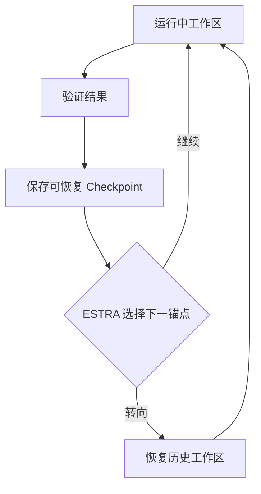

> **核心判断：**长周期研究的第一性问题不是让 Agent 多思考几千步，而是让它可以回到一个确实能运行的研究状态。ScienceFlow 把研究过程组织成多个可恢复的阶段。

## 为什么需要它

研究员在第十小时发现当前路线走不通，若只有一段模型总结“曾经做出过一个好模型”，却找不到对应代码、依赖与数据，就无法真正回滚。长时 Agent 同样会遇到上下文溢出、环境漂移、GPU 冲突和资源耗尽。文本记忆只能描述过去，不能恢复过去的可执行性。

## 它如何运行：让改进可回溯

ScienceFlow 用可执行工作区作为研究状态，状态同时绑定**代码和工件、验证证据、简化记忆、资源开销**。实验获得可信结果时，Stage Gate 归档状态。阶段终点由 **ESTRA（Executable-State Transition through Re-Anchoring）**判断：继续当前状态，或恢复一个历史节点重新探索。Evidence-aware execution controller 管理物理 GPU 作业，不替代研究策略判断。

重要的是**恢复不会返还已经消耗的时间或算力**。这与只保存 Git commit 有区别：数据环境和运行证据也是状态的一部分。[论文 §2](https://arxiv.org/abs/2608.14354)。

## 实验报告到底证明什么

作者在完整 **75 题 MLE-bench、24 小时/任务**设置中报告 **70.22±1.18% Any-Medal**，比论文所列最强已报告基线高 **4.92 个百分点**。但对照系统模型并不一致，所以不能将全部差距归因于 ESTRA。对资源更有说明力：把双 GPU 上限限制为一 GPU，成绩降至 **63.56±0.44%**；把增量状态改为完整快照，作者报告 **59.11±0.44%**，说明状态管理直接影响有效实验预算。[论文 Table 1、资源敏感性 §3](https://arxiv.org/abs/2608.14354)。

## 关键局限与反证

好的 checkpoint 机制未必带来好的研究方向；多路并发也可能让实验互相争抢 GPU 或共享数据。大规模数据集的完整快照不经济，而增量快照对外部依赖的一致性提出更高要求。论文结果只在特定工作负载与资源配置中成立，不能直接替代 MLE-Bench 官方统一复现。

## 对 Kaggle RSI System 的启发

你目前大量 RSI 实验卡在数据下载、环境搭建和超时，这恰好是 ScienceFlow 最值得先学的地方。建议在优化系统公共层保存镜像 digest、数据校验和只读缓存、环境锁文件、候选 commit、验证脚本、模型工件及累计预算。Resume 必须复用已下载内容、保持原截止时间和 cost cap，不必把整个 ScienceFlow 改写成通用 Agent 框架。

## 资料与复现入口

- [原论文](https://arxiv.org/abs/2608.14354)

*本文解读日期：2026-11-04。实验数据来源于作者，本文没有进行独立复现。*
