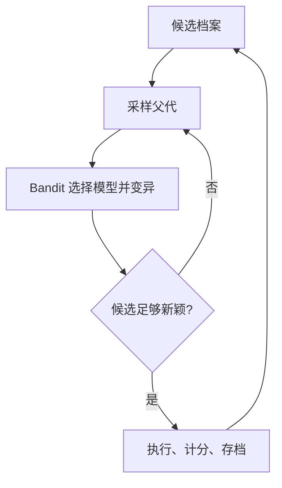

> **核心判断：**ShinkaEvolve 把演化搜索里的三类浪费分开处理：从哪个程序出发、哪些重复改动不值得运行、应该调用哪个 LLM。

## 为什么需要它

一个进化系统最大的成本不是提出想法，而是运行和评分。如果总从最佳程序微调，容易陷入局部最优；从任意父代随机搜索，又会反复试低质量方向；候选代码高度近似时，每次都重新执行训练，等于重复支付 GPU 费用。固定使用同一模型也忽视了不同模型的成功率差异。

## 它如何运行：让改进可回溯

**Weighted Parent Sampling** 兼顾高分父代和多样性；**Novelty Rejection Sampling** 在真正执行之前排除近重复候选；**Bandit-based LLM Ensemble** 根据历史改进收益动态选择生成模型。维护跨代候选档案，让好的中间解成为后续分支的踏脚石。

## 实验报告到底证明什么

作者报告在**圆填充**任务中用 **150 次候选采样**得到当时新的高质量解，并把方法应用到 **AIME 数学推理 Harness、ALE-Bench 竞赛程序和 MoE 负载均衡损失**。已发表于 **ICLR 2026**。这里的 150 指一个具体几何优化任务，不代表任意 Kaggle 比赛都能用 150 次实验赢得金牌。[ICLR 官方摘要](https://proceedings.iclr.cc/paper_files/paper/2026/hash/7886b9bafe76c52fd568db10ff9772df-Abstract-Conference.html)。

## 关键局限与反证

框架依赖有意义的可执行评分。语义新颖不代表分数更好，而细小补丁也可能很重要，因此去重阈值设置不当会错杀改进。Bandit 可能因为早期运气过度集中到某个模型。若每次执行很便宜，新颖性判断本身的模型费用可能不值得。进化程序档案也不是更新 LLM 权重。

## 对 Kaggle RSI System 的启发

对已有 Kaggle 执行平台，ShinkaEvolve 适合当完整黑盒 RSI Engine；但需要优先解决**精确实验缓存**：相同代码、数据版本和环境直接复用结果，再谈向量相似度判重。建议在固定成本下比较 `纯随机/贪心 -> 父代采样 -> 去重 -> Bandit` 的增量收益，避免把执行次数少当作必然胜利。

## 资料与复现入口

- [原论文](https://arxiv.org/abs/2509.19349)
- [官方代码仓库](https://github.com/SakanaAI/ShinkaEvolve)

*本文解读日期：2026-11-04。实验数据来源于作者，本文没有进行独立复现。*
